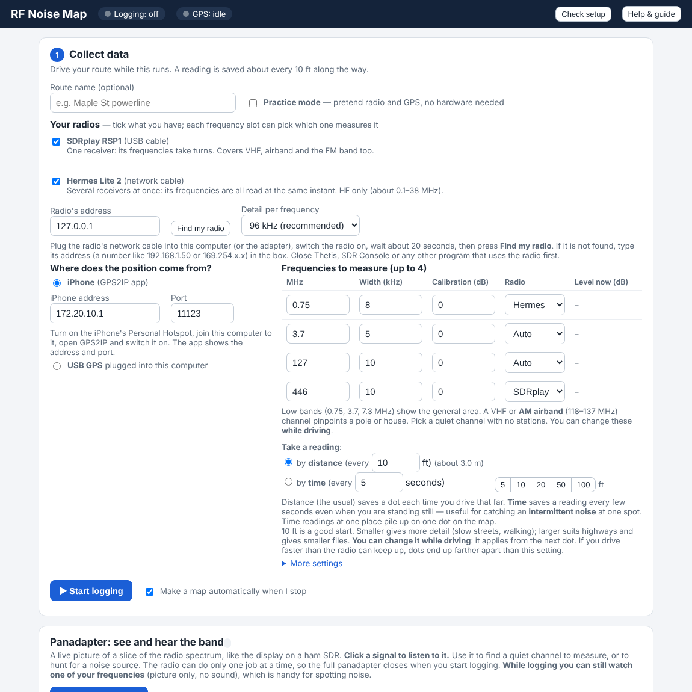
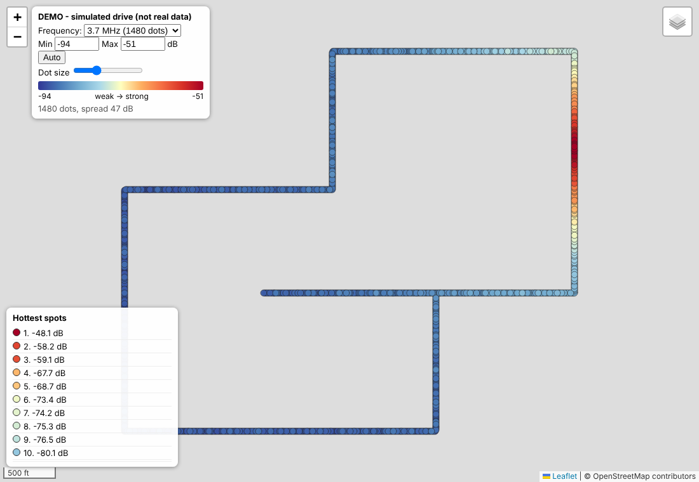
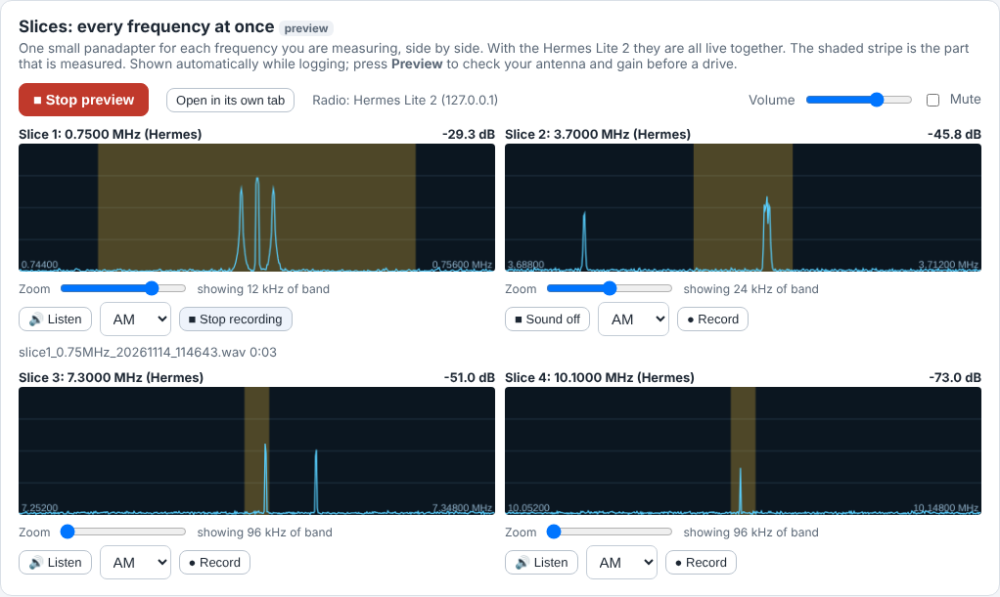
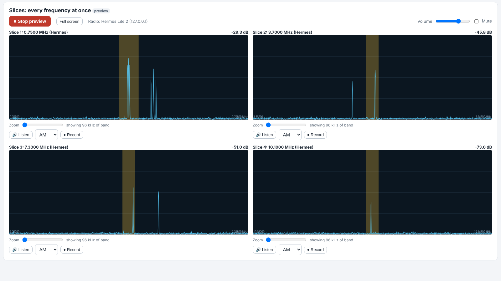

# RFNoise-Mapping

Find power-line and other radio noise by driving a route.

One or two software-defined radios (an **SDRplay RSP1**, a **Hermes Lite 2**, or both together) and a **GPS** log the signal level on up to four frequencies about every 10 feet. The program then draws a **street map of colored dots, blue (weak) to red (strong)**, so you can see where the noise is loudest and drive straight to it. Live panadapters, one per frequency, let you see and hear the noise as you drive.

> **Status: early testing.** Tested with simulated hardware, and on one Windows 11 PC with a real RSP1 and a USB GPS. The **Hermes Lite 2 support has only been tested against a simulated radio so far**, and a real drive has **not** been done yet. The Mac version is experimental. Please report what you find.

**New: [The Story of RF Noise Map](docs/The-Story-of-RF-Noise-Map.md)** ([download as PDF](docs/guides/The-Story-of-RF-Noise-Map.pdf)) — the idea, why distance, speed, several frequencies and a panadapter matter for finding noise, the problems we hit along the way, and what the product does today (with its limits). Inspired by the noise-hunting work of **Jeff Stuparits, W4DD**.

## What it does

- Reads up to **4 frequencies** you choose (for example 3.8 MHz, 7.1 MHz, 14.2 MHz, 50.1 MHz).
- Logs a reading about every **10 feet** while you drive, with the position from your GPS.
- Draws a **Leaflet street map**. Each dot is a reading: **blue = weak, red = strong**. Pick which frequency to look at.
- Has a **practice mode** with pretend radio and GPS, so you can try everything at home.
- Has a **panadapter**: a live spectrum and waterfall of the band with a built-in receiver (AM, USB, LSB, CW, narrow FM), so you can see and hear signals and pick frequencies to measure. (New, untested on the road.)
- Works with the **SDRplay RSP1** (USB), the **Hermes Lite 2** (network cable), or **both at once**: each of the four frequency slots picks which radio measures it. The Hermes Lite 2's receivers all run at the same time, so its frequencies are read at the same instant; the SDRplay covers VHF, airband and 70 cm. (Hermes Lite 2 support is new: tested against a simulated radio, not yet on a real one.)
- Shows a live **slices** view: a small panadapter for every frequency you measure, side by side. Hermes Lite 2 slices also have **sound and per-slice WAV recording, even while driving** - handy for hearing the buzz rise and fall as you pass a pole.
- Saves every reading with its time to the millisecond, so a map can be made with **one dot every X feet** worked out from the clock, whatever speed you drove.
- Has built-in checks: **Check setup**, **Find my GPS** and a one-minute **Full test**.

*The map above uses practice data, not a real drive.*

*The Slices view: one live panadapter per measured frequency - each with its own zoom slider, and on Hermes Lite 2 slots sound and per-slice recording, even while driving. (Simulated radio shown.)*

*"Open in its own tab" shows only the four slices, large, with a Full screen button - handy on a second screen in the car.*

## How it works

1. The **radio** (SDRplay RSP1, Hermes Lite 2, or both, as you choose for each frequency) measures signal strength on each of your frequencies.
2. The **GPS** (a USB puck, or an iPhone running the GPS2IP app) says where you are.
3. The **logger** pairs each reading with a position and saves a CSV file in your drive folder.
4. The **map maker** turns the CSV into a map (HTML file) you open in any web browser. Zoom in on the red spots.

You control it from a simple page in your browser (the "control panel"). It runs on your own computer; nothing is sent over the internet except the map tiles.

## Download and install

You do **not** need a GitHub account.

### Windows (main version, Windows 10 and 11)

1. Go to the [**Releases** page](../../releases/latest).
2. Under **Assets**, click **Install_RFNoise_Windows.bat**. Your browser saves it, normally in **Downloads**. (If it warns that the file may be harmful, choose **Keep**.)
3. Double-click it. If Windows says "Windows protected your PC", click **More info**, then **Run anyway**.
4. Answer the short questions. It finds (or installs) the right Python, installs the helpers, finds your GPS, and puts icons on your Desktop. Suggested folder: `C:\RadioScripts`.
5. Plug in the radio and GPS, and say **yes** to the full test at the end.

**Do not click "Source code (zip)" or "Source code (tar.gz)".** Those are for programmers.

For the real radio you also need **SDRplay API** and **PothosSDR** from their own websites; the installer explains it. Practice mode needs neither.

### Mac (experimental, untested)

1. On the Releases page, click **RFNoise_Mac_v1.3.0.zip** under Assets. Double-click it in Downloads to unzip. Keep the `mac` and `app` folders together.
2. Open the `mac` folder, right-click **Install_RFNoise.command**, choose **Open**, then **Open** again.
3. Follow the steps in the window. See [mac/README_Mac.txt](mac/README_Mac.txt).

### Full guide

The **Install and User Guide (PDF)** is here: [docs/guides/RFNoise-Mapping-guide.pdf](docs/guides/RFNoise-Mapping-guide.pdf). It is also built into the program (**Help & guide** button).

## If something does not work

- **Check setup** button: tells you in plain words what is missing (Python, radio library, radio, GPS).
- **Find my GPS** button: finds a USB GPS puck and its speed by itself.
- **Full test** (`Test_Everything.bat`): checks everything in about a minute, with a pretend drive and a map.
- **Radio or GPS busy:** only one program can use the radio or a GPS port at a time. The program closes its own leftovers, and lists other SDR or GPS programs (SDRuno, SDRconnect, SDR Console, HDSDR, u-center and similar) with a button to close them. Nothing else is closed without your OK.

## Folders in this repository

| Folder | What is in it |
|---|---|
| `app/` | The program (Python) and the control panel |
| `installer-src/` | Source used to build `Install_RFNoise_Windows.bat` |
| `mac/` | Mac installer (experimental) |
| `docs/guides/` | Install and User Guide (PDF) |
| `docs/release-notes/` | What changed in each version |
| `docs/images/` | Screenshots |

## No warranty

Shared by one radio operator, "as is", with **no warranty**. Use at your own risk. Always drive safely: let a passenger watch the screen, or stop to look.

Design and on-air testing by **KW4EX**.

Not made, approved or supported by SDRplay, Elecraft, FlexRadio, Thetis, Zeus or NereusSDR. Those names belong to their owners.

## Licence

[MIT](LICENSE) - Copyright (c) 2026 KW4EX
