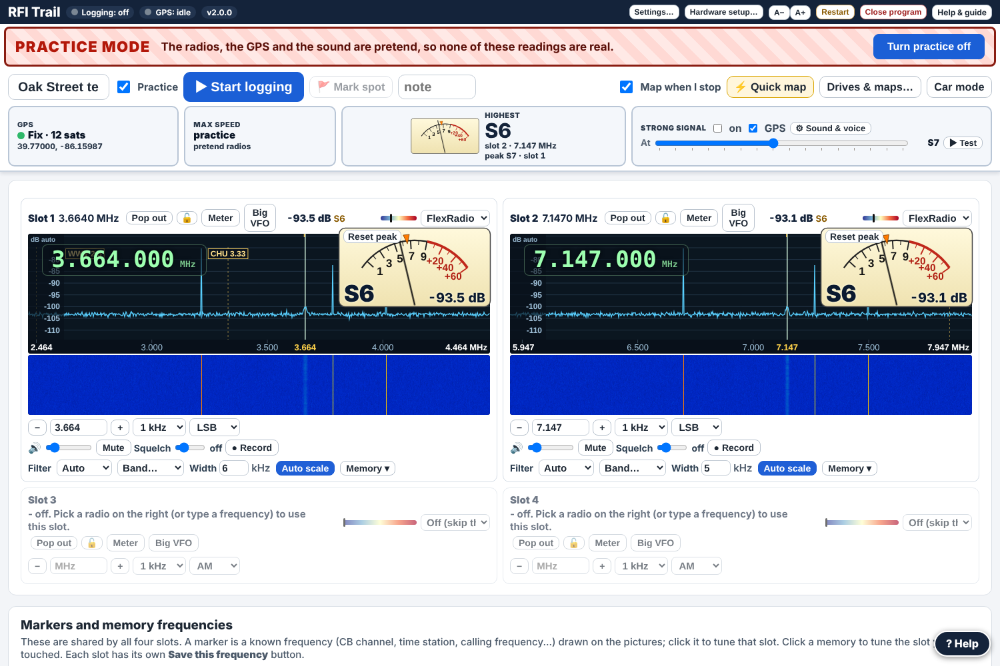
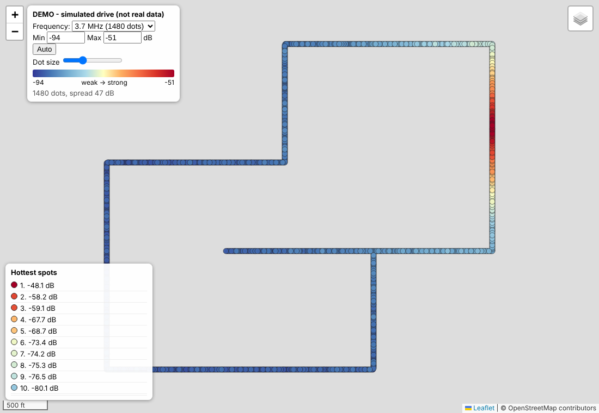
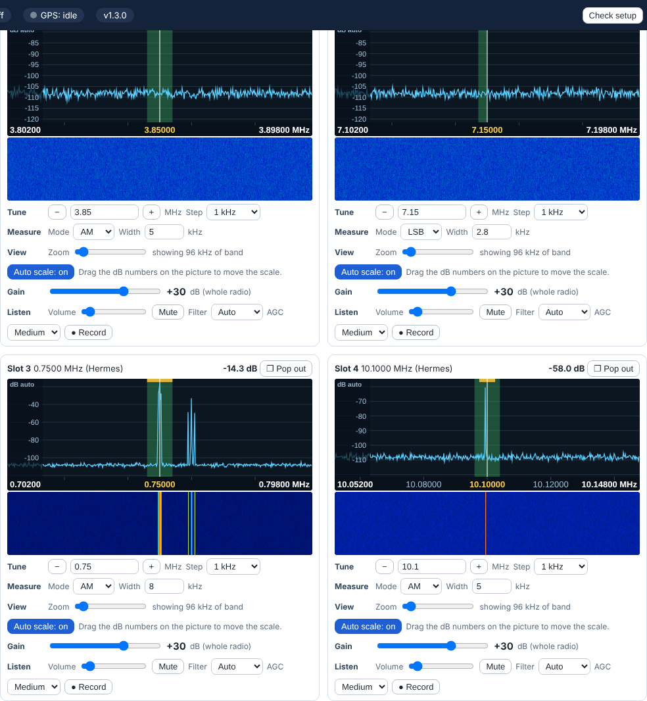
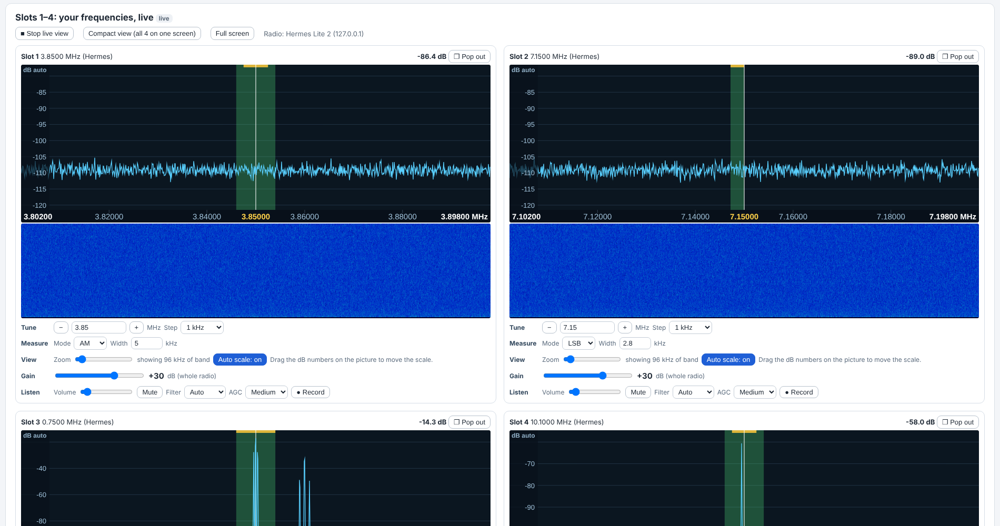

# RFNoise-Mapping

Find power-line and other radio noise by driving a route.

Up to four software-defined radios (an **SDRplay RSP1**, a **Hermes Lite 2**, and low-price **RTL-SDR dongles**, in any mix) and a **GPS** log the signal level on up to four frequencies about every 10 feet. The program then draws a **street map of colored dots, blue (weak) to red (strong)**, so you can see where the noise is loudest and drive straight to it. Live panadapters, one per frequency, let you see and hear the noise as you drive.

> **Testing status (1.4.0p):** some testing is done, but **not all features have been confirmed as field ready**. The new Windows install layout (folder RFNoise_Mapping) has been tested on a Windows 11 PC. Not yet confirmed in real drives: the USB GPS puck, the S-meters and Warning sounds with real radios, and **Test my setup** with every radio type. Please treat this as a testing version. It is shared as is, with **no warranty. Use at your own risk.** Design and on-air testing by KW4EX.
>
> **Latest version: 1.4.0 (testing version).** Tested with simulated hardware, and on a Windows 11 PC and a Mac with a real SDRplay RSP1, a real Hermes Lite 2 and a GPS. A long real drive with every radio has **not** been done yet, and the new **RTL-SDR dongle support has only been tried with simulated dongles**. The Mac version is experimental. Please report what you find.
>
> **Latest test build (1.4.0p):** a bigger top bar with a hardware line (GPS, slot radios, max speed), a separate **Hardware setup** window, **Test my setup**, **S-units** next to every dB value, and four large **S-meters**. See [the release notes](docs/release-notes/v1.4.0.md).
>
> **What is new in 1.4.0:** up to four radios at once, any radio in any of the four slots (new: RTL-SDR dongles). Since 1.3.0: Hermes Lite 2 auto gain and gain per band, a Hermes picture-speed choice, a Mac network setup for the Hermes (USB Ethernet adapter, Wi-Fi left on), Chrome opens by default for sound, and many fixes. See [the release notes](docs/release-notes/v1.4.0.md).

**New: [The Story of RF Noise Map](docs/The-Story-of-RF-Noise-Map.md)** ([download as PDF](docs/guides/The-Story-of-RF-Noise-Map.pdf)) — the idea, why distance, speed, several frequencies and a panadapter matter for finding noise, the problems we hit along the way, and what the product does today (with its limits). Inspired by the noise-hunting work of **Jeff Stuparits, W4DD**.

## What it does

- Reads up to **4 frequencies** you choose (for example 3.8 MHz, 7.1 MHz, 14.2 MHz, 50.1 MHz).
- Logs a reading about every **10 feet** while you drive, with the position from your GPS.
- Draws a **Leaflet street map**. Each dot is a reading: **blue = weak, red = strong**. Pick which frequency to look at. Ten backgrounds (street, satellite, terrain, topo, USGS, grey, dark, none), switchable **power lines and poles**, **heat glow**, a second frequency as rings, **drive replay**, and **Street View / navigate** links on every dot.
- **RTL-SDR dongles (new in 1.4.0, untested on real dongles):** up to four low-price USB dongles (for example the RTL-SDR Blog V3). Any dongle can serve any of the four slots, and dongles read at the same time. Find my dongles, a gain slider per dongle, and automatic direct sampling for HF on the V3. See the guide.
- **Hermes gain help:** an optional **Auto gain (listening only)** that backs off on overload, **Gain per band** that remembers your gain for each band, and a **Hermes picture** speed (Smooth / Normal / Light) you can change while the program runs.
- Has a **practice mode** with pretend radio and GPS, so you can try everything at home.
- Every frequency slot is a full **panadapter**: a live spectrum and waterfall of the band with a built-in receiver (AM, SAM, USB, LSB, CW, narrow and broadcast FM) so you can see and hear signals and pick frequencies to measure. (New, untested on the road.)
- Works with the **SDRplay RSP1** (USB), the **Hermes Lite 2** (network cable), or **both at once**: each of the four frequency slots picks which radio measures it. The Hermes Lite 2's receivers all run at the same time, so its frequencies are read at the same instant; the SDRplay covers VHF, airband and 70 cm. (Hermes Lite 2 support is new: tested against a simulated radio, not yet on a real one.)
- Shows **four large slots**, stacked one under the other: each frequency is its own panadapter with a **waterfall**, labelled Slot 1-4 (a Compact view fits all four on one screen; **Pop out** opens one in its own tab). Each slot has a **Radio** chooser (**Off**, **Hermes** or **SDRplay**), so any number of slots can be used. Hermes slots are always live and have sound and WAV recording even while driving. The SDRplay has one tuner, so one SDRplay slot at a time is **Live** (press its **Live** button) with every feature - centre and width of view, all modes, sound, recording, squelch, attenuation and auto gain - while the other SDRplay slots keep their settings and last picture. Controls a radio does not have are hidden.
- Every slot can be **tuned on the spot**: type a frequency (in the slot or in the readings table - both change together), use the - / + buttons, the mouse wheel or the arrow keys, click a signal or a **known-frequency marker** (CB, WWV, calling frequencies...) on the picture, or use **Jump to band**; **Lock** a slot so it cannot change by accident; save and recall **memory frequencies** shared by all slots; set the filter, squelch and gain; and grab the **dB scale** with the mouse to move it, like Thetis or SmartSDR.
- A **drive bar** under the title keeps Start / Stop, Pause, **Mark spot**, big **speed**, the **real dot spacing at your speed**, a GPS and data **health strip with an alarm**, an optional **noise tone**, a **live track map** and a passenger **car mode** always in view, with a one-press **Quick map**. Maps can be limited to chosen **slots, radios, frequencies, speeds or levels**, mark **flat channels**, and list **places where several frequencies rise together** (a strong sign of one noise source).
- **Pause recording** at a traffic light: no dots are saved and every slot goes back to a full live picture (an SDRplay slot shows only its latest reading while mapping, because it must retune between frequencies). **Pause automatically** does it by itself after you have not moved for a number of seconds, and resumes when you move.
- Saves every reading with its time to the millisecond, so a map can be made with **one dot every X feet** worked out from the clock, whatever speed you drove.
- A **Close program** button sits at the top of the panel; if a drive is being recorded it asks first, then saves the drive and closes. The panel shows its version number, and warns you if new program files were installed while an older copy is still running.
- Has built-in checks: **Check setup**, **Find my GPS** and a one-minute **Full test**.

*The map above uses practice data, not a real drive.*

*Slots 1-4: a full panadapter with a waterfall per frequency, each with its own radio, tuning, gain, grab-to-move dB scale, volume, recording and Pop out. (Simulated radio shown.)*

*"Open in its own tab" shows only the four slots, large, with a Full screen button - handy on a second screen in the car.*

## How it works

1. The **radio** (SDRplay RSP1, Hermes Lite 2, RTL-SDR dongles, or a mix, as you choose for each frequency) measures signal strength on each of your frequencies.
2. The **GPS** (a USB puck, or an iPhone running the GPS2IP app) says where you are.
3. The **logger** pairs each reading with a position and saves a CSV file in your drive folder.
4. The **map maker** turns the CSV into a map (HTML file) you open in any web browser. Zoom in on the red spots.

You control it from a simple page in your browser (the "control panel"). It runs on your own computer; nothing is sent over the internet except the map tiles.

## Download and install

You do **not** need a GitHub account.

### Windows (main version, Windows 10 and 11)

1. Go to the [**Releases** page](../../releases) and open the newest version at the top of the list (**v1.4.0**; its *Pre-release* label only means it is still being tested).
2. Under **Assets**, click **Install_RFNoise_Windows.bat**. Your browser saves it, normally in **Downloads**. (If it warns that the file may be harmful, choose **Keep**.)
3. Double-click it. If Windows says "Windows protected your PC", click **More info**, then **Run anyway**.
4. Answer the short questions. It finds (or installs) the right Python, installs the helpers, finds your GPS, and puts icons on your Desktop. Suggested folder: `C:\RadioScripts`.
5. Plug in the radio and GPS, and say **yes** to the full test at the end.

**Do not click "Source code (zip)" or "Source code (tar.gz)".** Those are for programmers.

For the real radio you also need **SDRplay API** and **PothosSDR** from their own websites; the installer explains it. Practice mode needs neither.

### Mac (experimental)

**Hermes Lite 2 on a Mac (network changes):** plug the radio into a USB-to-Ethernet adapter and leave **Wi-Fi on**. Wait about 30 seconds until **System Settings > Network** shows the adapter with a green dot and a self-assigned address starting **169.254** (normal; keep *Configure IPv4: Using DHCP*, do not type an address). Allow **Local Network** access if macOS asks. Since 1.3.0b the program searches for the radio out of every network port, so nothing else needs changing. The program opens in **Google Chrome** (Safari holds the sound back); the *Open the program in* setting changes that. Full steps are in the guide and in [mac/README_Mac.txt](mac/README_Mac.txt).

1. On the Releases page, click **RFNoise_Mac_v1.4.0.zip** under Assets. Double-click it in Downloads to unzip. Keep the `mac` and `app` folders together.
2. Open the `mac` folder, right-click **Install_RFNoise.command**, choose **Open**, then **Open** again.
3. Follow the steps in the window. See [mac/README_Mac.txt](mac/README_Mac.txt).

### Full guide

The **Install and User Guide (PDF)** is here: [docs/guides/RFNoise-Mapping-guide.pdf](docs/guides/RFNoise-Mapping-guide.pdf). It is also built into the program (**Help & guide** button).

## If something does not work

- **Check setup** button: tells you in plain words what is missing (Python, radio library, radio, GPS).
- **Find my GPS** button: finds a USB GPS puck and its speed by itself.
- **Full test** (`Test_Everything.bat`): checks everything in about a minute, with a pretend drive and a map.
- **Radio or GPS busy:** only one program can use the radio or a GPS port at a time. The program closes its own leftovers, and lists other SDR or GPS programs (SDRuno, SDRconnect, SDR Console, HDSDR, u-center and similar) with a button to close them. Nothing else is closed without your OK.

## Folders in this repository

| Folder | What is in it |
|---|---|
| `app/` | The program (Python) and the control panel |
| `installer-src/` | Source used to build `Install_RFNoise_Windows.bat` |
| `mac/` | Mac installer (experimental) |
| `docs/guides/` | Install and User Guide (PDF) |
| `docs/release-notes/` | What changed in each version |
| `docs/images/` | Screenshots |

## No warranty

Shared by one radio operator, "as is", with **no warranty**. Use at your own risk. Always drive safely: let a passenger watch the screen, or stop to look.

Design and on-air testing by **KW4EX**.

Not made, approved or supported by SDRplay, Elecraft, FlexRadio, Thetis, Zeus or NereusSDR. Those names belong to their owners.

## Licence

[MIT](LICENSE) - Copyright (c) 2026 KW4EX
