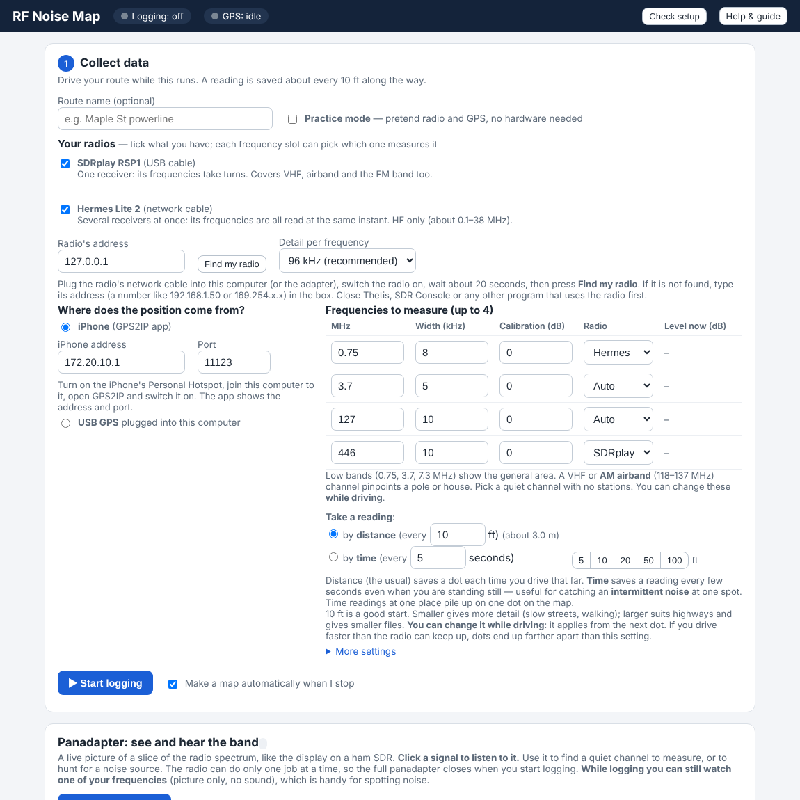
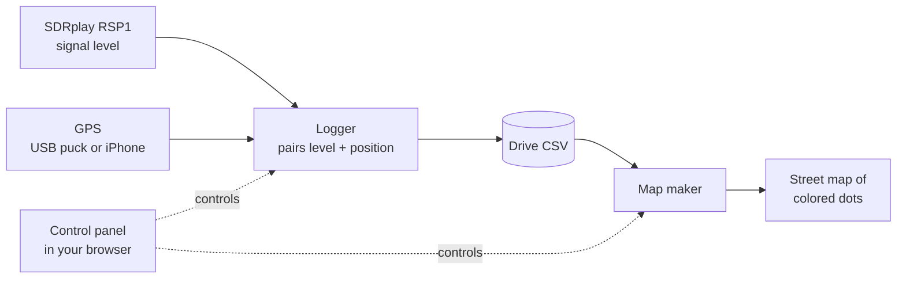
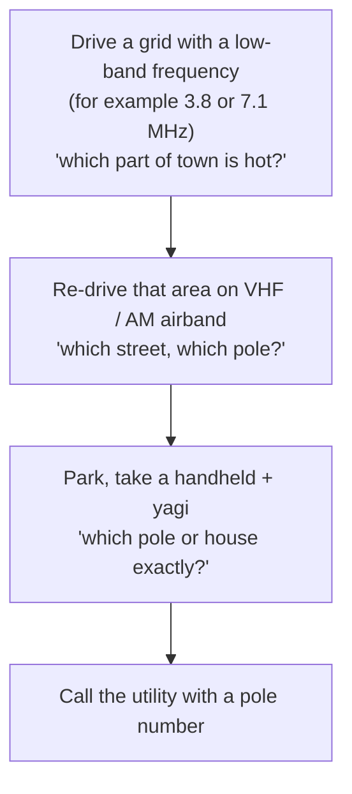

# The Story of RF Noise Map

*How a ham's "I wish I could just see where the noise is" became a drive-around noise-hunting tool — the idea, the road bumps, and what it does today.*

> **Honest status:** this is a **testing version**. It has been exercised with simulated radio and GPS, on a Windows 11 PC with a real SDRplay RSP1 and a USB GPS, and its Mac installer has been run on a MacBook. A full real-world noise-hunting drive is the next milestone, and this page says plainly where things are proven and where they are not.

---

## With thanks: Jeff Stuparits, W4DD

**This program exists because of ham operator Jeff Stuparits, W4DD.** Jeff is the inspiration for it and the source of many of its ideas. He developed a similar noise-mapping tool of his own, **uses it often**, and has used it on many occasions to help KW4EX and many other operators isolate noise.

The way of thinking behind RF Noise Map came from Jeff: that you can hunt noise by driving and recording where it is, and how to go about it. KW4EX has said plainly that without the knowledge Jeff shared, he would never have thought of the task, let alone how to approach it. RF Noise Map is a small program built on that generosity. Thank you, Jeff. 73.

---

## Contents

1. [The problem: power-line noise is a ghost](#1-the-problem-power-line-noise-is-a-ghost)
2. [The idea: let the car do the walking](#2-the-idea-let-the-car-do-the-walking)
3. [Why distance, not time — and why speed matters](#3-why-distance-not-time--and-why-speed-matters)
4. [Why more than one frequency](#4-why-more-than-one-frequency)
5. [Why a panadapter belongs in a noise-hunting tool](#5-why-a-panadapter-belongs-in-a-noise-hunting-tool)
6. [How it was built — a development diary](#6-how-it-was-built--a-development-diary)
7. [Problems we hit and how they were solved](#7-problems-we-hit-and-how-they-were-solved)
8. [Making it supportable: logs, a problem finder, clean uninstalls](#8-making-it-supportable-logs-a-problem-finder-clean-uninstalls)
9. [The product today](#9-the-product-today)
10. [Known limitations](#10-known-limitations)
11. [What comes next](#11-what-comes-next)

---

## 1. The problem: power-line noise is a ghost

Every ham who has chased a "buzz" knows the routine. The S-meter jumps from S2 to S7 on 40 meters. You can hear a rough, frying-bacon crackle or a 120-Hz buzz. It comes and goes with the weather. You *know* it's something on the power system — a failing insulator, a loose hardware clamp, a bad transformer, a leaky streetlight, a neighbor's cheap switching supply — but the noise is **everywhere and nowhere**:

- Low-frequency (HF) noise from a single faulty pole can be heard **blocks away**, so the loudest spot depends on wiring, terrain and the way the line carries the noise, not just on where the fault is.
- A handheld radio and a directional antenna *will* find it eventually — but only after you've narrowed it down to the right neighborhood. Walking a whole town with a yagi is not a plan.
- The utility needs a pole number or an address. "Somewhere near the park" gets a polite shrug.

The tools that exist for this are either professional (calibrated, expensive, aimed at utilities) or manual (one radio, one pair of ears, a lot of patience). Nothing sat in the middle for a ham who already owns an SDR and a laptop.

## 2. The idea: let the car do the walking

The core idea is simple enough to say in one breath:

> **Drive the streets. Every few feet, record how strong the noise is *and exactly where you are*. Afterwards, paint it on a map — blue for quiet, red for loud — and the noisy spots simply show up.**

The pieces:

| Piece | Job |
|---|---|
| **SDRplay RSP1** | Measures signal level on the frequencies you choose |
| **GPS** (USB puck, or an iPhone running the GPS2IP app) | Says where you are |
| **Logger** | Pairs every reading with a position and saves a CSV |
| **Map maker** | Turns the CSV into a Leaflet street map of colored dots you open in any browser |
| **Control panel** | A simple page in your browser that runs the whole thing |

The hunt then has three natural stages, each narrower than the last:

The map doesn't replace the handheld and the yagi. It **tells you where to point them**, which is the part that used to cost a whole weekend.

## 3. Why distance, not time — and why speed matters

### Reading every N feet, not every N seconds

An obvious way to log is "one reading per second." It gives uneven, misleading maps:

- Sitting at a red light you'd record dozens of identical points on one spot.
- Crawling through a neighborhood you'd get a dense smear; on a highway, big gaps.
- The map's color pattern would reflect **how you drove**, not **where the noise is**.

So RF Noise Map saves a reading **each time you've moved a set distance** — **10 feet by default**, adjustable from 2 ft up to a mile, even **while driving**. Every dot then stands for the same stretch of road, the picture is evenly covered, and colors compare fairly from street to street. A typical pole span is on the order of a hundred-some feet, so ten-foot dots show a noisy pole as a clear peak rather than a lucky single sample.

### Speed is the hidden budget

Distance sampling turns your speed into a **measurement-rate requirement**:

| Speed | Feet per second | Readings per second at 10 ft |
|---|---|---|
| 15 mph | 22 | 2.2 |
| 25 mph | 37 | 3.7 |
| 35 mph | 51 | 5.1 |
| 45 mph | 66 | 6.6 |

At 45 mph the radio has roughly **a sixth of a second** to measure *every* frequency you've chosen, and the more frequencies, the less time for each. If you drive faster than the radio can keep up, dots simply end up farther apart than the setting — that's visible and honest, but worth knowing. That's why the dot spacing is a control you can change on the fly: tighten it for slow neighborhood streets, relax it for the highway.

### The GPS is always a little in the past

A phone GPS typically reports **once per second**. At 45 mph, a one-second-old position is **66 feet behind where the car actually is** — about a whole utility-pole span of error, which is exactly the thing you're trying to resolve. Two things address it:

1. **The logger slides each fix forward** along your direction of travel by the fix's age (a short, well-understood dead-reckoning step). On a straight road this is very good; in a sharp turn it can be off by a few feet.
2. **A faster GPS helps.** A 10-updates-per-second USB puck brings the error down to a few feet at speed, which is why the guide recommends one for highway-speed work.

### …and the one time you *do* want time

Distance sampling has a blind spot: a noise that is **intermittent** — it turns on and off, while you're parked beside the suspect pole. Standing still means no distance covered, so no new readings. The newest option fixes that: choose **by time** and take a reading every X seconds (say 5) even when standing still. Parked at one spot, you get a time-history of the noise — is it a regular arc cycle, does it come with the wind, does it stop when the neighbor's heater cycles off? (Time readings from one place pile onto one dot of the map, which is exactly what you'd expect.)

## 4. Why more than one frequency

RF Noise Map reads **up to four frequencies** on every pass. That isn't a luxury — it's the single most useful trick for narrowing the search, and it comes straight from how noise behaves:

- **Low bands (for example 0.75, 3.7, 7.3 MHz) are the "general area" bands.** Power-line noise is rich at HF, and it travels along the wires and radiates widely. Low-band readings light up a whole neighborhood. They answer "which part of town?" — and they're quiet-ish where nothing's wrong, so contrast is good.
- **VHF and the AM airband (118–137 MHz) are the "pinpoint" bands.** Higher up, the noise from a faulty pole falls off much faster with distance, so only the region right around the source stays red. They answer "which pole, which house?"
- **Comparing bands tells a story.** A source that is strong on HF and gone on VHF is probably far away or a weak emitter; one that shines on all four is near and nasty. A noise that appears only in the *higher* channels may be a local device (a switching supply, a LED driver) rather than the power line itself.
- **One drive, four maps.** Because the four readings are taken at the same positions, you switch between the colored-dot maps without re-driving.
- **A "safety net" against a bad channel.** If somebody keys up a transmitter on one of your frequencies, you've still got three clean ones.

A note from the field that shaped the design: the operator found that tuning an **AM aircraft-band frequency on a handheld 2-meter radio with a directional yagi** tracks power-line noise *better* than FM signals do. That fits the physics: FM receivers are built to *reject* amplitude noise (limiting, capture effect), which is precisely what impulsive power-line noise is, while an AM receiver passes it straight through to your ears. It's why the guide singles out the AM airband for pinpointing, and why AM is the start-up mode of the built-in receiver.

> **Practical note:** the RSP1 is a single-tuner radio, so the four frequencies are measured **one after another** within each reading, not literally simultaneously. At driving speeds the positions differ by a few feet, which doesn't matter for the 10-foot map. A dual-tuner SDR is a possible future upgrade.

## 5. Why a panadapter belongs in a noise-hunting tool

For a long time the program only measured the four numbers you typed in. That works — *if* you picked good frequencies. And that's the catch: **a poor frequency choice quietly ruins a whole drive.**

- If a broadcast station or a ham net is sitting on your "noise" frequency, you're mapping **that station**, not the power line. The map looks fine and means nothing.
- If the band is crowded or the radio is being overloaded by a strong local signal, your readings are bent before they begin.
- You can't tell by staring at a single number whether the quietest-looking channel is actually clear, or whether the noise has a recognizable *character*.

A **panadapter** — a live **spectrum** (signal vs. frequency) over a scrolling **waterfall** (history, with newest at the top) — fixes this by letting you *see* the band the way the radio sees it:

- **Find a clear channel.** The noise floor and every carrier are laid out in front of you. Pick a gap that's empty hour after hour.
- **Recognize the noise.** Power-line arcing and other impulse noise show up as a broad raised floor or vertical streaks in the waterfall; switching power supplies make evenly spaced combs of lines; a lone carrier is a station or an oscillator. Different shapes, different suspects.
- **Listen to it.** A built-in receiver (AM, **SAM**, USB, LSB, CW, narrow FM, broadcast FM) with selectable bandwidth lets you click a signal and hear it. The *sound* of noise — a rough 120-Hz buzz, a frying crackle, a steady hum — is a diagnostic in its own right.
- **Assign what you found.** One button sends the tuned frequency to any of your four mapping slots — what you see and hear becomes what you measure.
- **Watch while you log.** During a drive the picture (not the sound) keeps running for any one of your frequencies, so you can see the noise rise and fall as you pass things. And a live **"Level now (dB)"** column next to your frequency list shows the current reading of each, with a bar.
- **Recognize the *station* too.** Known-frequency markers (CB 1–40, WWV/CHU, NOAA weather, ham calling channels, airband, marine, FRS/GMRS) are drawn on the picture so you can tell "that's a known signal" from "that's mystery noise" at a glance — click one to tune and centre it.

In short: the map tells you **where**; the panadapter makes sure you're measuring **the right thing**.

## 6. How it was built — a development diary

The project grew in layers, each one prompted by something the previous layer exposed. (It was designed, tested and steered by KW4EX, with **Claude** doing the programming work alongside.)

**Phase 1 — The core loop.** A logger that reads the SDRplay and a GPS and writes a CSV; a map maker that turns the CSV into a Leaflet map with a blue-to-red color scale; a **practice mode** with a pretend radio and a pretend GPS driving a loop around a few blocks, so everything can be exercised at a desk. Early on came the two-GPS decision: an **iPhone with the GPS2IP app** (simplest in the field) or a **USB GPS puck** (faster updates, better at speed).

**Phase 2 — A control panel anyone can use.** A radio operator isn't a programmer, so the program became a small web app in the browser — Python's standard library only, no frameworks to install: choose GPS, choose frequencies, Start, Stop, Make map, email the result. Built-in **Check setup**, **Find my GPS** and a one-minute **Full test** that explain in plain words what's missing instead of throwing stack traces.

**Phase 3 — One-click installers.** A Windows `.bat` that finds or installs the right Python, installs the helper libraries, copies the program to `C:\RadioScripts\RFNoise` (or wherever you choose), creates shortcuts and runs a self-test. A Mac installer that does the same job on macOS, including the harder parts (below). A first **pre-release** — clearly marked *TESTING VERSION* — went out on GitHub so the operator could pull it onto other computers for testing.

**Phase 4 — Real-world shakedown.** Running on a real MacBook and a real Windows PC exposed a string of "works on the dev machine" problems — the next section is a catalogue.

**Phase 5 — The panadapter.** Spectrum + waterfall + a built-in receiver, then a long run of refinements as it was used: click-to-tune, mode and bandwidth choices, dragging/swiping to pan, auto-centering, a bigger and brighter frequency scale, a **width-of-view slider**, a **signal meter**, **1 Hz tuning steps**, a big green/red **VFO lock** so you can't nudge the frequency by accident, **memory frequencies**, **audio recording** (small 8 kHz µ-law WAV files, about 29 MB an hour, with play/save/delete), a **CB band** and an option to **widen the view to show the whole band**, clickable **known-frequency markers**, **SAM** and **broadcast-FM** modes, and **Left/Right arrow keys** for tuning.

**Phase 6 — Making it supportable.** A persistent **program error log**, a retained **install log**, a plain-language **problem finder** in both installers, a **support-file** button that bundles it all into one zip, and **uninstallers** that show what's installed and let you choose what to keep. More in section 8.

## 7. Problems we hit and how they were solved

A few of the more instructive ones:

### "The radio library only works with one Python" (Windows)
The free **PothosSDR** radio-library bundle ships Python bindings built for **one specific Python version** (3.9). Install the "newest" Python and the radio silently isn't found.
**Fix:** the installer *reads which Python version PothosSDR was built for* and uses (or installs, via winget) exactly that one, and tells you to re-run the installer if you add PothosSDR later.

### Blank page and a silent panel (Mac and Windows)
Early on, if the control panel hit a problem the browser just showed a blank page.
**Fix:** a connection check, and panel errors now appear *on the page* in plain words.

### Homebrew in the wrong place (Apple silicon Macs)
Apple-silicon Macs keep Homebrew in a different folder than Intel Macs, so tools "weren't there."
**Fix:** the installer looks in both places and puts the right one on the path.

### macOS and the Documents folder
When the program was launched from a desktop icon, macOS **privacy protections blocked access to Documents**, so saving a drive or reading settings failed.
**Fix:** data now lives in `~/RF Noise Map`, which isn't protected; existing settings are migrated.

### numpy refusing to load — the Rosetta trap (Mac)
On an Apple-silicon Mac whose Terminal was running under Rosetta, the Python math library (`numpy`) had the wrong architecture and failed to import.
**Fix:** the program starts **natively** (`arch -arm64`) and gives a clear message if it detects the mismatch.

### "Apple cannot check it for malicious software" (Mac)
A downloaded, unsigned script is blocked by Gatekeeper — normal, but scary to a non-expert.
**Fix:** the installer and README explain it in plain steps and clear the quarantine flag for you.

### The SDRplay driver won't build: "'cstring' file not found" (Mac)
The Mac radio driver is built from source; on some Macs the Command Line Tools install lacked the C++ headers, so the build died with a cryptic compiler message.
**Fix:** the installer detects exactly that and repairs it, then re-points the SoapySDRPlay3 module at the installed SDRplay API library when it can't find it.

### The desktop icon says "not responding" (Mac)
Launching the program *became* the Python process, so macOS thought the app had hung — and starting it a second time gave an error.
**Fix:** the launcher now starts the program in the background and exits at once. If a copy is already running it asks you: **open it, close it and start fresh, or cancel.**

### Quit left a browser window behind
**Fix:** Quit now also closes the browser tab (Safari, Chrome, Edge, Brave, Arc on the Mac; macOS may ask once for permission).

### Automatic gain was quietly changing the numbers
The panadapter's *automatic gain* — great for listening — would have changed the radio's sensitivity from moment to moment, making recorded levels from one end of a drive incomparable with the other.
**Fix:** recording **never** uses automatic gain. The IF/RF **attenuation** numbers you choose are the same ones the recording uses, can be changed while driving (with a warning that earlier and later dots are no longer directly comparable), and a **Reset to defaults** button (IF 40 dB, RF 0) brings them home if they ever drift.

### An installer that diagnosed itself
While building the Mac problem finder, a test showed it "finding" errors in its own explanatory text. **Fix:** the installer's own lines are tagged in the log and the finder only reads the raw output of the tools it ran.

### Smaller, but telling
- The signal meter and several controls moved *next to* the thing they affect after a few drives of use.
- **Dot spacing** went from a buried setting to a front-page control with quick buttons.
- Closing the program had to be re-timed so the Mac launcher didn't mistake a normal Quit for a crash.
- Every slow button now shows **what the program is doing** while it works, so you never wonder if it froze.

## 8. Making it supportable: logs, a problem finder, clean uninstalls

A program a non-programmer runs in a car has to explain itself when things go wrong.

- **Install log** — every install writes a log that is **kept** (the newest ten) in the install folder's `Logs` folder, plus a copy outside the install folder so even a *failed* install leaves evidence.
- **Program error log** — the panel, the logger and the panadapter (and JavaScript errors in the browser page) record problems to `Logs/program_errors.log`, with duplicate-suppression so one repeating fault doesn't fill the disk.
- **Problem finder** — when an install step fails, the installer matches the raw error against a catalogue of known causes (no internet, SSL/proxy blocks, missing C++ runtime, access denied, a full disk, Python missing or the wrong version, driver and radio-library mismatches, a damaged download, a busy port, and more) and prints **what went wrong, why, what to do, and a web page to read**.
- **Support file** — one button (or one `.bat`/`.command`) bundles the logs and basic PC details into a single zip you can send for help. Nothing is uploaded; private keys are left out.
- **Pre-flight and health check** — the installer first checks the OS version, free disk space and internet. Run it again on an existing install and it offers **upgrade/repair**, a **check that changes nothing**, or **uninstall**.
- **Uninstallers that respect your data** — they show what's installed and how big your data is, then you choose: *program only* (keep drives, maps, recordings), *program plus data* (a backup zip is made first; if the backup fails nothing is deleted), or *everything* (you must type `DELETE`). On Windows it also removes Start-menu entries, shortcuts and the *Apps & features* entry, and keeps a record of what it did.
- **Windows extras** — Start menu folder, an entry in Windows *Settings → Apps*, and a `/silent` mode for experts.

## 9. The product today

**RF Noise Map v1.2.1 (testing version)** — a free, open, stand-alone tool for amateur radio. *Design and on-air testing by KW4EX.* MIT licensed.

### Noise mapping
- Up to **4 frequencies** logged at the same time, **changeable while driving**; any frequency from about **0.75 MHz to the VHF range** your SDRplay covers.
- Readings saved **by distance** (default 10 ft, 2 ft to a mile, adjustable while driving) **or by time** (every X seconds, even when stationary) for intermittent noise.
- GPS from a **USB puck** (auto-detected, with a "Find my GPS" test) or an **iPhone** (GPS2IP app); position **corrected for GPS delay** at speed.
- **Fixed, user-chosen attenuation** during recording for comparable results; **never** automatic gain while recording.
- **Practice mode** with a pretend radio and GPS, so you can learn the program at home.
- **Leaflet street map** of colored dots (blue → red) per frequency; also **Google Earth (.kml)** export and an **email-ready zip**; backups.
- A **live "Level now (dB)"** readout per frequency while recording.

### Panadapter (see and hear the band)
- Live **spectrum + waterfall**, views from **250 kHz to 8 MHz wide** (and a **width slider**), auto-scale, drag/swipe to pan, auto-centre.
- **Built-in receiver**: AM, **SAM** (synchronous AM), USB, LSB, CW, narrow FM and **broadcast FM** (mono); selectable bandwidth, squelch, signal meter, audio spectrum.
- **Tuning**: click to tune, tuning steps from **1 Hz** up, **Left/Right arrow keys** (Shift = ten steps), a big **VFO lock**, **memory frequencies** (starter list, save/delete).
- **Band jump** (AM broadcast, ham bands, **CB**, 6 m, airband, 2 m, 70 cm, **FM broadcast**) with an option to **widen the view to the whole band**.
- **Clickable known-frequency markers** (CB 1–40, time stations, NOAA weather, ham calling, airband, marine, FRS/GMRS) with show/hide groups.
- **Audio recording** to small, universal WAV files with play, save, show-in-folder and delete.
- **Assign** any tuned signal to one of the four mapping slots; **watch while logging** (picture only).
- Optional **automatic gain for listening only**, with user-set IF/RF attenuation shared with recording and a **Reset to defaults** button.

### Installing and supporting it
- **Windows 10/11:** one-click `Install_RFNoise_Windows.bat` — finds or installs the matching Python, installs helpers, sets shortcuts (Desktop, Start menu, sign-in), self-tests; **repair/upgrade menu**, **silent mode**, **Apps & features** entry, uninstaller with options.
- **Mac:** `Install_RFNoise.command` with the same ideas — pre-flight, a Homebrew/driver build that repairs itself, health check, support zip, an uninstaller with a backup option, and a launcher that detects a running copy.
- **Logs and a problem finder** in both; the in-panel **Tools** card shows recent problems, opens the log folder and makes a support file.
- An illustrated **Install and User Guide** (built into the program, and as a PDF).

## 10. Known limitations

Being straight about these is part of the job:

- **Not yet proven on a long real drive.** The logger, GPS handling, map and installers have been tested with simulated hardware and on real equipment, but a full noise-hunting drive with results checked against a known source is still ahead.
- **Levels are relative, not calibrated.** The numbers are **dBFS** (relative to the radio's full scale), good for *comparing places* and bands, **not** for absolute field-strength measurements or for proving compliance.
- **One tuner, measured in turn.** The RSP1 can't measure four frequencies at the same instant; the four are taken one after another within a reading. At high speed with several channels, readings get spread out (dots end up farther apart than your setting).
- **Position accuracy is bounded by your GPS.** A 1-per-second phone GPS is corrected by dead-reckoning but is weaker in sharp turns, tunnels, and urban canyons. A faster USB puck is better at speed.
- **A map shows *where it's loud*, not always *the source*.** Noise can travel along wires; the highest-reading street may be a few poles away from the fault. The map gets you close; a handheld radio and yagi (or the utility's own tools) finish the job.
- **Panadapter limits.** Views are **8 MHz at most** (the whole FM band, for example, doesn't fit at once); the outer edges of the picture are less accurate. **SAM** uses a carrier-tracking filter rather than a full phase-locked loop; **broadcast FM is mono** (no stereo or RDS); there is no noise blanker or notch filter yet. You can **watch but not listen/tune** while logging, because the radio is busy measuring.
- **Only one program can use the radio at a time.** The program offers to close SDRuno, SDRconnect, SDR Console, HDSDR and similar.
- **Radio drivers come from elsewhere.** You need the **SDRplay API** (and **PothosSDR** on Windows) from their own sites; the installer explains how. On the Mac the SDRplay driver is built from source, which is sensitive to the Mac's developer tools.
- **Mac is the newer, less-proven platform.** The installer and panel have been run on a MacBook, but not every path (real radio drives, every browser, audio recording on the Mac, trackpad swiping, the widest views) has been verified in the field.
- **The Windows installer isn't code-signed**, so SmartScreen shows a warning (More info → Run anyway). The installer is plain text you can read in Notepad.
- **Map tiles need internet.** The map draws its street background from the internet (a phone hotspot works); your data itself never leaves your computer.
- **Capped at four frequencies**, and a measurement in time mode piles readings onto one dot.
- **Not a safety tool.** Always drive safely: have a passenger watch the screen, or stop to look.

## 11. What comes next

Ideas on the table, roughly in order of how much they'd help the next real drive:

1. **A real field test write-up** — a known noisy pole, mapped, found, and photographed.
2. **A second SDR** (dual-tuner or two radios) so two bands are truly simultaneous.
3. **Easier "walk-around" mode** for the final handheld stage (a pared-down phone-friendly view).
4. **Noise-blanker and notch filters** in the receiver; **stereo FM**.
5. **Comparing two drives** (before and after the utility's repair) on the same map.
6. **A cheaper-SDR recommendation page** once other radios have been tried.

Your feedback is the fuel for this list — if you try it, please report what you find on the [Issues](../../issues) page. Include the **support file** (one click away) and what happened, in your own words.

---

*With thanks to Jeff Stuparits, W4DD, for the inspiration and the knowledge that started it all.*

*Shared by one radio operator, "as is", with no warranty. Always drive safely. 73 — KW4EX.*
